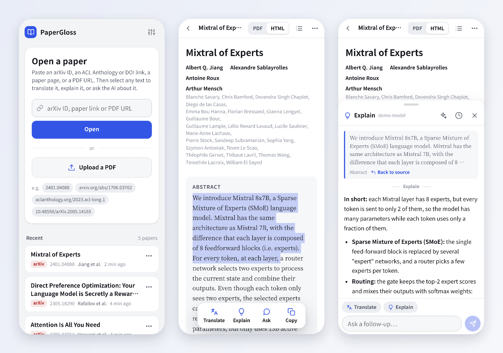
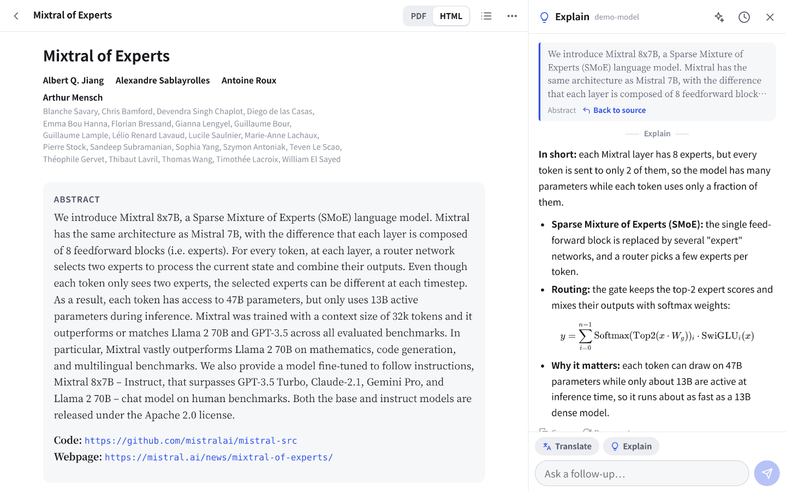

<p align="center"></p>

<h1 align="center">PaperGloss</h1>

<p align="center">A web-based, AI-powered paper reader built for mobile.</p>

<p align="center">English · <a href="README.zh-CN.md">简体中文</a></p>



PaperGloss is a self-hosted web app for reading research papers in any browser, designed first for phones. Open an arXiv paper or upload a PDF, then select any text to translate it, explain it, or ask your own LLM about it.

## Features

- **Import from many sources.** arXiv IDs and links (alphaXiv, Hugging Face Papers, ar5iv and papers.cool links work too), ACL Anthology, DOIs, direct PDF links, and paper pages that expose `citation_pdf_url` (NeurIPS, PMLR and many publishers). You can also upload a local PDF.
- **Two reading modes.**
  - **HTML** (arXiv papers): arXiv's own HTML rendering, reflowed to the screen width, with real math (MathML). Text size and font are adjustable.
  - **PDF**: the original layout. Pinch to zoom; double-tap a column to zoom to its width, double-tap again to reset; outline and page jump.
- **Select to translate, explain or ask.** Long-press any text and pick an action. The surrounding paragraph goes along as context, formulas from the HTML version are sent as LaTeX, and a single word gets a dictionary-style entry.
- **Region capture** (PDF mode): drag a box around a formula, figure or table and ask a vision-capable model about it.
- **Follow-up questions.** Every selection becomes a small conversation; "Back to source" jumps to where it came from.
- **Ask about the whole paper**, with the full text as context.
- **Reference previews.** Tapping a citation, figure reference or footnote opens a preview card instead of jumping away.
- **History.** Conversations are stored per paper on the server, so they follow you across devices.
- **Bring your own model.** Anthropic (through the official SDK) or any OpenAI-compatible API: OpenAI, DeepSeek, Gemini, Qwen, Kimi, GLM, SiliconFlow, OpenRouter, Ollama, or a relay.
- English and Chinese interface, dark mode, reading position saved, installable to the home screen.



## Quick start

Requires Node.js 20 or later.

```bash
git clone https://github.com/shenyizg/papergloss.git
cd papergloss
npm install
npm start
```

Open <http://localhost:8787>. On first start the server prints a generated access password; only a hash of it is stored, so note it down (see [Forgot the password?](#forgot-the-password)). Sign in, open **Settings**, choose a provider, paste your API key, pick a model, and tap **Test connection**.

## Configuration

| Variable | Purpose | Default |
|---|---|---|
| `PORT` | Port to listen on | `8787` |
| `HOST` | Address to bind; use `127.0.0.1` to allow local access only | `0.0.0.0` |
| `DATA_DIR` | Where papers, settings and history are stored | `./data` |
| `PAPERGLOSS_PASSWORD` | Set the access password from the environment (never written to disk) | — |
| `HTTPS_PROXY` / `HTTP_PROXY` / `NO_PROXY` | Proxy for outbound requests (arXiv, model APIs), with the same rules as curl; `localhost` is always reached directly | — |
| `PAPERGLOSS_NO_PROXY=1` | Ignore the proxy variables above | — |
| `PAPERGLOSS_TRUST_PROXY=1` | Trust `X-Forwarded-*` headers from any peer, for a reverse proxy on another machine or in another container (by default only a proxy on the same machine is trusted) | — |
| `PAPERGLOSS_ALLOW_PRIVATE_URLS=1` | Allow importing papers from this machine or the local network (blocked by default) | — |

Everything else (provider, model, answer language, prompts, interface language) is set in the app.

### Forgot the password?

Stop the server, delete the `passwordHash` line from `data/config.json` and start it again: a new password is printed. Alternatively, set `PAPERGLOSS_PASSWORD`.

## Models

- **Anthropic** goes through the official TypeScript SDK. The default model is `claude-opus-5-5`. Translation runs at low effort and everything else at medium; you can change this per action under **Settings → Advanced**. The system prompt is marked for prompt caching, which matters most for whole-paper questions. On the official API with Claude Opus 5.5, Opus 5, Sonnet 5.5 or Fable 5.1, requests declined by a safety classifier are retried on Anthropic's recommended fallback model (`fallbacks: "default"`).
- **OpenAI-compatible APIs** use Chat Completions with streaming. Most base URLs end in `/v1`. **Fetch list** in Settings reads the provider's model list.
- Region capture and figure explanations need a model that accepts images.

The answer language ("Translate into / answer in") is separate from the interface language, so you can use an English interface and get translations in Chinese.

## Using it on a phone

- If your phone and the server are on the same network or VPN, open `http://<server-ip>:8787`.
- To reach it from the internet, put an HTTPS reverse proxy in front, for example with Caddy:

  ```
  paper.example.com {
      reverse_proxy 127.0.0.1:8787
  }
  ```

  and set `HOST=127.0.0.1` so only the proxy can reach it. Other reverse proxies work too; keep the original `Host` header (Caddy does this by default, Apache needs `ProxyPreserveHost On`). If the proxy runs on another machine or in another container, set `PAPERGLOSS_TRUST_PROXY=1` so that the sign-in limit applies to each client instead of to the proxy.
- In Safari, **Share → Add to Home Screen** opens it full screen like an app.

## Running as a service

`~/.config/systemd/user/papergloss.service`:

```ini
[Unit]
Description=PaperGloss

[Service]
WorkingDirectory=/path/to/papergloss
ExecStart=/usr/bin/node server/index.js
Environment=PORT=8787
Restart=on-failure

[Install]
WantedBy=default.target
```

```bash
systemctl --user daemon-reload
systemctl --user enable --now papergloss
loginctl enable-linger $USER   # keep running after you log out
```

If the server needs a proxy to reach arXiv or your model provider, add `Environment=HTTPS_PROXY=...` as well.

## Privacy and security

- Everything stays on your server under `data/`: PDFs, cached HTML, settings and conversations.
- The model provider receives only what a request needs: the selected text with its surrounding paragraph and the paper's title and abstract; the full text when you ask about the whole paper; the image when you capture a region.
- The API key is stored in `data/config.json` (file mode 600). The browser only ever sees a masked preview, and the server only sends the key to the address it was saved for: switching providers or base URLs needs that provider's key.
- Access is protected by a password, stored as an scrypt hash, and an HttpOnly session cookie. Sessions last 180 days and are renewed while you use the app; changing the password signs out every device. Sign-in attempts are limited to 10 per address per 10 minutes.
- Requests from other sites, including other subdomains of your domain, can't change anything.
- Paper links can't reach this machine or your local network (such as `127.0.0.1`, `192.168.x.x` or cloud metadata addresses), also not through redirects, unless `PAPERGLOSS_ALLOW_PRIVATE_URLS=1` is set.
- Use HTTPS whenever the server is reachable beyond your own network.

## Data layout

```
data/
  config.json            access password hash, AI settings (including the API key)
  papers/<id>/
    meta.json            title, authors, abstract, reading position
    paper.pdf
    paper.html           cached arXiv HTML
    assets/              cached HTML images
    threads/<tid>.json   AI conversations
```

Deleting a paper removes its whole folder.

## Known limitations

- OpenReview now puts programmatic downloads behind a human-verification check, so OpenReview papers have to be downloaded in a browser and uploaded.
- Some publishers block non-browser downloads in the same way.
- Scanned PDFs without a text layer can't be selected; use region capture instead.
- Whole-paper questions use text extracted from the PDF, where formulas and tables may be garbled. The arXiv HTML version gives cleaner text.

## Project layout

```
server/            Node.js backend (no framework)
  index.js         routes and startup
  sources.js       input parsing, PDF downloads, arXiv metadata and HTML
  papers.js        library, HTML cache, conversations
  llm/             anthropic.js (official SDK), openai.js (OpenAI-compatible)
  i18n.js          server messages in English and Chinese
  net.js           proxy-aware fetch
public/            frontend: plain ES modules, no build step
  assets/js/       reader.js, pdfview.js, htmlview.js, aipanel.js, ai.js (prompts), i18n.js, …
test/              server tests (node:test)
```

There is no build step: edit the files under `public/` and reload the page; restart the server after changing `server/`. `npm test` runs the server tests.

## License

[MIT](LICENSE). Bundled third-party code is listed in [THIRD_PARTY_NOTICES.md](THIRD_PARTY_NOTICES.md).

The screenshots show *Mixtral of Experts* (Jiang et al., [arXiv:2401.04088](https://arxiv.org/abs/2401.04088), CC BY 4.0). The answers in them come from a demo model.
