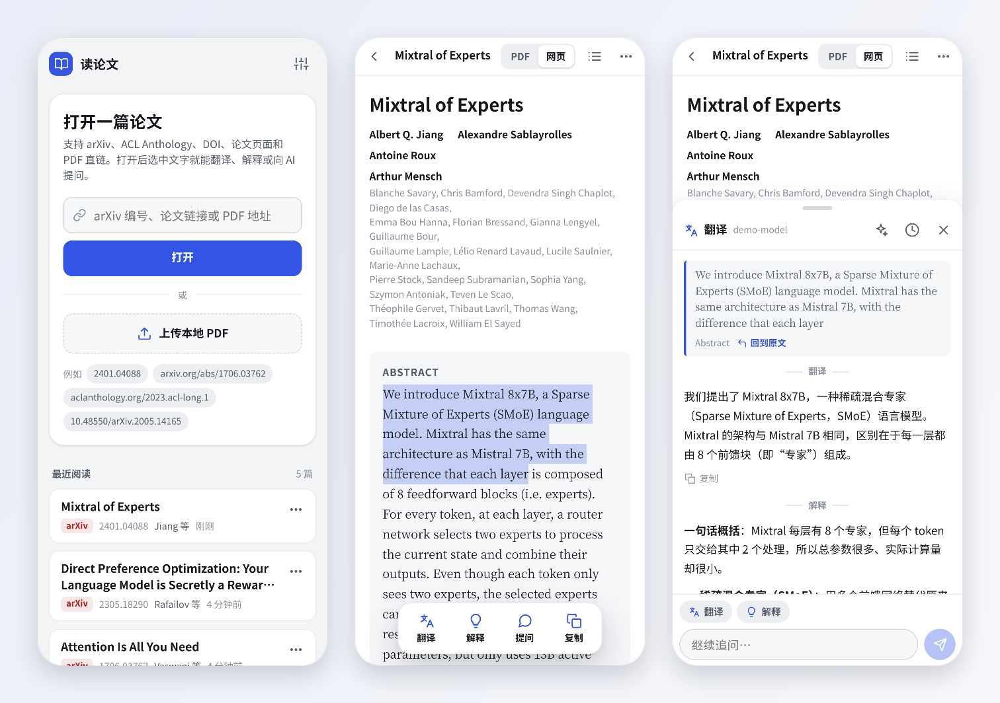
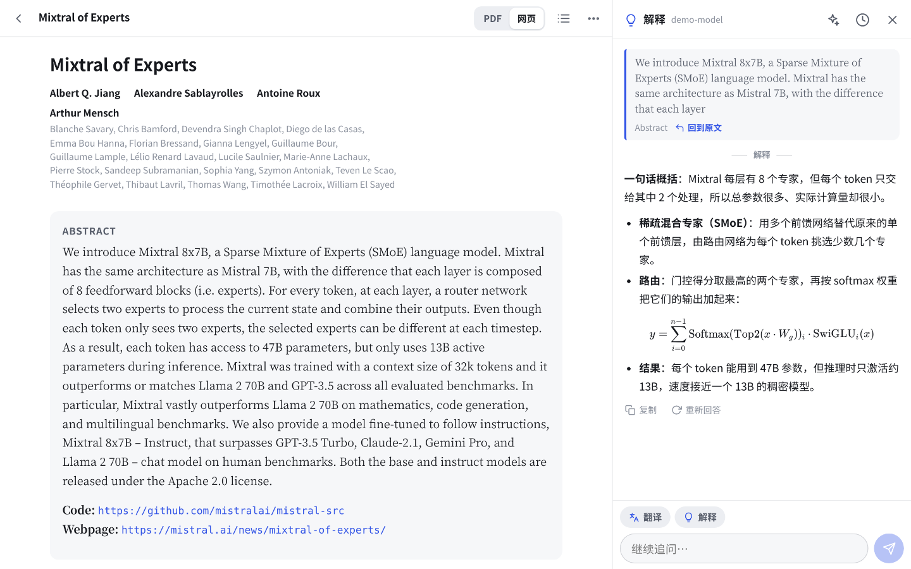

<p align="center"></p>

<h1 align="center">PaperGloss（读论文）</h1>

<p align="center">Web 端 AI 驱动的移动论文阅读器。</p>

<p align="center"><a href="README.md">English</a> · 简体中文</p>



PaperGloss 是一个自托管的论文阅读网页，任何浏览器都能用，首先为手机设计。导入 arXiv 论文或上传 PDF，选中任意文字就能翻译、解释，或者用你自己的大模型 API 提问。

## 功能

- **多种来源导入**：arXiv 编号或链接（也认 alphaXiv、Hugging Face Papers、ar5iv、papers.cool 的链接）、ACL Anthology、DOI、PDF 直链，以及带 `citation_pdf_url` 的论文页面（NeurIPS、PMLR 和很多出版社）。也可以直接上传本地 PDF。
- **两种阅读模式**：
  - **网页版**（arXiv 论文）：用 arXiv 官方的 HTML 渲染，文字随屏幕宽度自动换行，公式是 MathML。可以调字号、切换字体。
  - **PDF**：原版式。双指缩放；双击某一栏放大到栏宽，再双击还原；有目录和页码跳转。
- **划词翻译、解释、提问**：长按选中文字后选一个操作。所在段落会作为上下文一起发给模型，网页版里的公式以 LaTeX 发送，单个词按词典格式解释。
- **框选截图**（PDF 模式）：框住公式、图或表，交给支持图片输入的模型解释。
- **追问**：每次划词都是一个小对话，可以接着问；「回到原文」能跳回出处。
- **全文问答**：把整篇论文作为上下文提问。
- **引用预览**：点引用编号、图表编号或脚注，先弹出预览卡片，不会直接跳走。
- **AI 记录**：问答按论文保存在服务器上，换设备也能看到。
- **自带模型**：Anthropic（官方 SDK），或任意 OpenAI 兼容接口：OpenAI、DeepSeek、Gemini、通义千问、Kimi、智谱 GLM、硅基流动、OpenRouter、Ollama，或中转地址。
- 中英文界面、深色模式、自动保存阅读位置，可以添加到主屏幕。



## 快速开始

需要 Node.js 20 或更高版本。

```bash
git clone https://github.com/shenyizg/papergloss.git
cd papergloss
npm install
npm start
```

打开 <http://localhost:8787>。第一次启动时服务器会生成访问密码并打印出来，也会保存在 `data/config.json`。登录后打开**设置**，选服务商，填 API Key 和模型，再点**测试连接**。

## 配置

| 变量 | 作用 | 默认值 |
|---|---|---|
| `PORT` | 端口 | `8787` |
| `HOST` | 监听地址；只想本机访问就设成 `127.0.0.1` | `0.0.0.0` |
| `DATA_DIR` | 论文、设置和问答记录的存放位置 | `./data` |
| `PAPERGLOSS_PASSWORD` | 用环境变量指定访问密码（不写入磁盘） | — |
| `HTTPS_PROXY` / `HTTP_PROXY` / `NO_PROXY` | 访问 arXiv 和模型接口时走的代理，规则和 curl 一样；`localhost` 总是直连 | — |
| `PAPERGLOSS_NO_PROXY=1` | 忽略上面的代理设置 | — |

其余设置（服务商、模型、回答语言、提示词、界面语言）都在网页里改。

## 模型

- **Anthropic** 走官方 TypeScript SDK，默认模型是 `claude-opus-5-5`。翻译用低推理强度，其他操作用中等，可以在**设置 → 高级设置**里按操作分别调整。系统提示词开启了提示缓存，对全文问答最有用。用官方接口调用 Claude Opus 5.5、Opus 5、Sonnet 5.5 或 Fable 5.1 时，如果请求被安全策略拒绝，会自动改由 Anthropic 推荐的备用模型回答（`fallbacks: "default"`）。
- **OpenAI 兼容接口**用 Chat Completions 流式输出，Base URL 一般以 `/v1` 结尾。设置里的**获取列表**会读取服务商的模型列表。
- 框选截图和图片解释需要支持图片输入的模型。

回答使用的语言（「翻译成 / 回答使用的语言」）和界面语言是分开设置的：界面用英文，翻译照样可以是中文。

## 在手机上使用

- 手机和服务器在同一个网络或 VPN 里时，直接打开 `http://服务器IP:8787`。
- 要从外网访问，建议在前面加一个 HTTPS 反向代理，比如 Caddy：

  ```
  paper.example.com {
      reverse_proxy 127.0.0.1:8787
  }
  ```

  同时把 `HOST` 设成 `127.0.0.1`，只让反向代理访问。
- 在 Safari 里点**分享 → 添加到主屏幕**，就能像 App 一样全屏打开。

## 后台常驻

`~/.config/systemd/user/papergloss.service`：

```ini
[Unit]
Description=PaperGloss

[Service]
WorkingDirectory=/path/to/papergloss
ExecStart=/usr/bin/node server/index.js
Environment=PORT=8787
Restart=on-failure

[Install]
WantedBy=default.target
```

```bash
systemctl --user daemon-reload
systemctl --user enable --now papergloss
loginctl enable-linger $USER   # 退出登录后继续运行
```

如果服务器要通过代理才能访问 arXiv 或模型接口，再加一行 `Environment=HTTPS_PROXY=...`。

## 隐私与安全

- 所有数据都在你自己服务器的 `data/` 目录里：PDF、网页版缓存、设置和问答记录。
- 发给模型服务商的只有每次请求需要的内容：选中的文字和所在段落、论文标题和摘要；全文问答时是全文；框选截图时是那张图片。
- API Key 保存在 `data/config.json`（文件权限 600），浏览器只能看到打码后的预览。
- 访问需要密码，登录状态保存在 HttpOnly Cookie 里。服务器能被外网访问时请务必使用 HTTPS。

## 数据目录

```
data/
  config.json            访问密码、AI 设置（含 API Key）
  papers/<id>/
    meta.json            标题、作者、摘要、阅读位置
    paper.pdf
    paper.html           arXiv 网页版缓存
    assets/              网页版图片缓存
    threads/<tid>.json   AI 问答记录
```

删除论文会把它的整个目录删掉。

## 已知限制

- OpenReview 现在会对程序下载做人机验证，需要在浏览器里下载 PDF 后上传。
- 部分出版社也会拦截非浏览器的下载请求，同样需要手动下载后上传。
- 没有文字层的扫描版 PDF 无法选中文字，可以改用框选截图。
- 全文问答用的是从 PDF 提取的文字，公式和表格可能不完整；arXiv 网页版提取的内容更准确。

## 目录结构

```
server/            Node.js 后端（无框架）
  index.js         路由与启动
  sources.js       解析输入、下载 PDF、抓取 arXiv 元数据和网页版
  papers.js        论文库、网页版缓存、问答记录
  llm/             anthropic.js（官方 SDK）、openai.js（OpenAI 兼容）
  i18n.js          服务器提示的中英文文案
  net.js           支持代理的 fetch
public/            前端：原生 ES 模块，无需构建
  assets/js/       reader.js、pdfview.js、htmlview.js、aipanel.js、ai.js（提示词）、i18n.js…
```

不需要构建：改完 `public/` 里的文件刷新页面即可；改了 `server/` 需要重启服务。

## 许可证

[MIT](LICENSE)。项目里包含的第三方代码见 [THIRD_PARTY_NOTICES.md](THIRD_PARTY_NOTICES.md)。

截图里的论文是 *Mixtral of Experts*（Jiang et al., [arXiv:2401.04088](https://arxiv.org/abs/2401.04088)，CC BY 4.0），截图中的回答来自演示模型。
